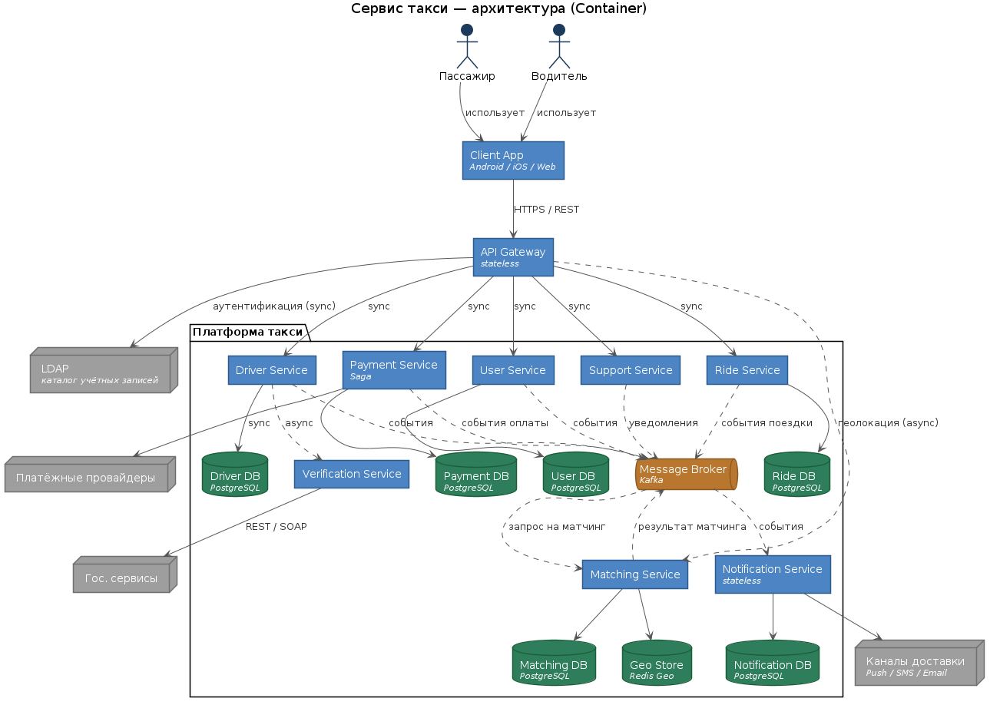
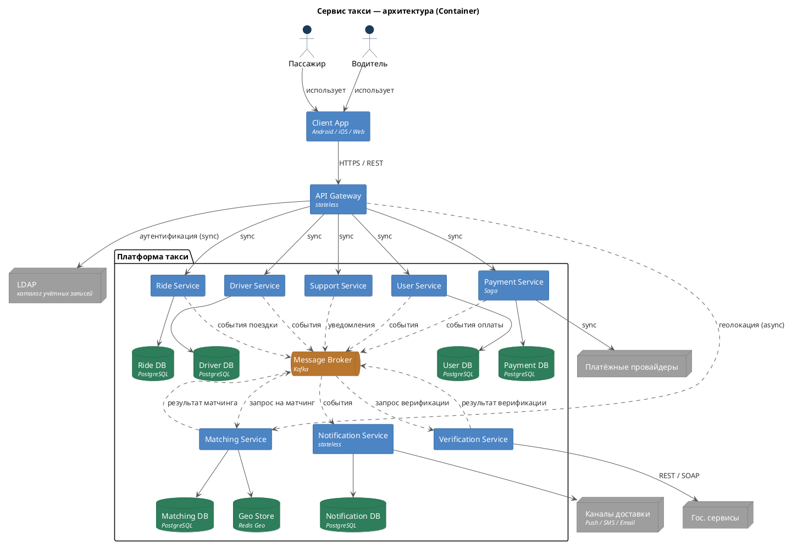
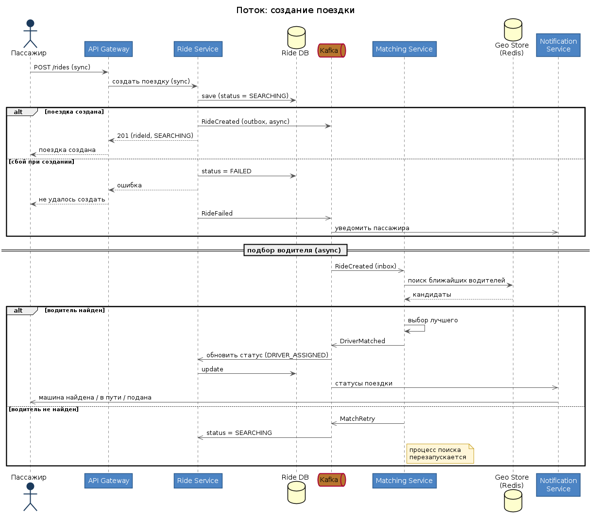
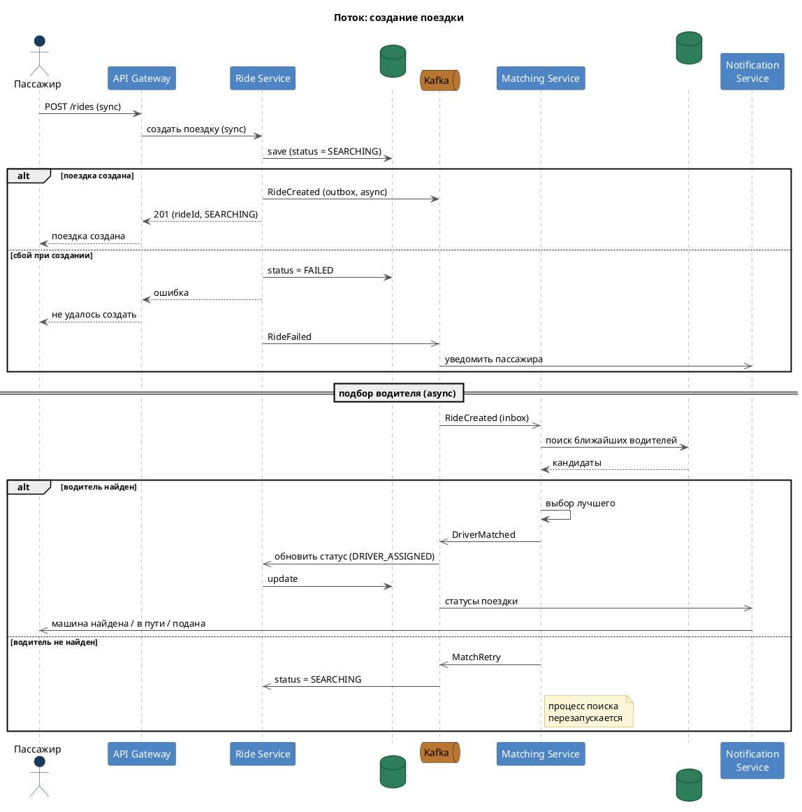
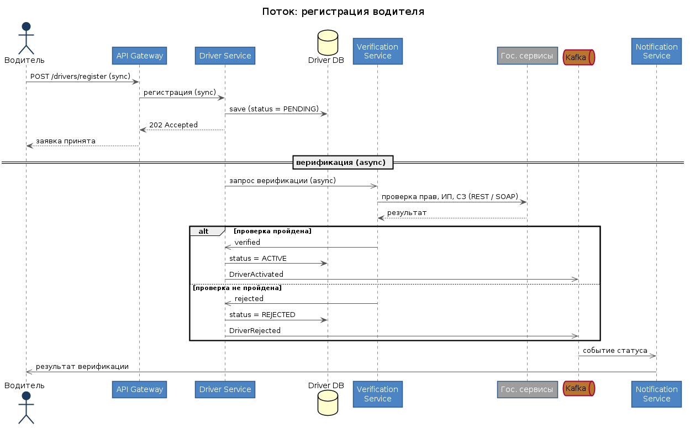
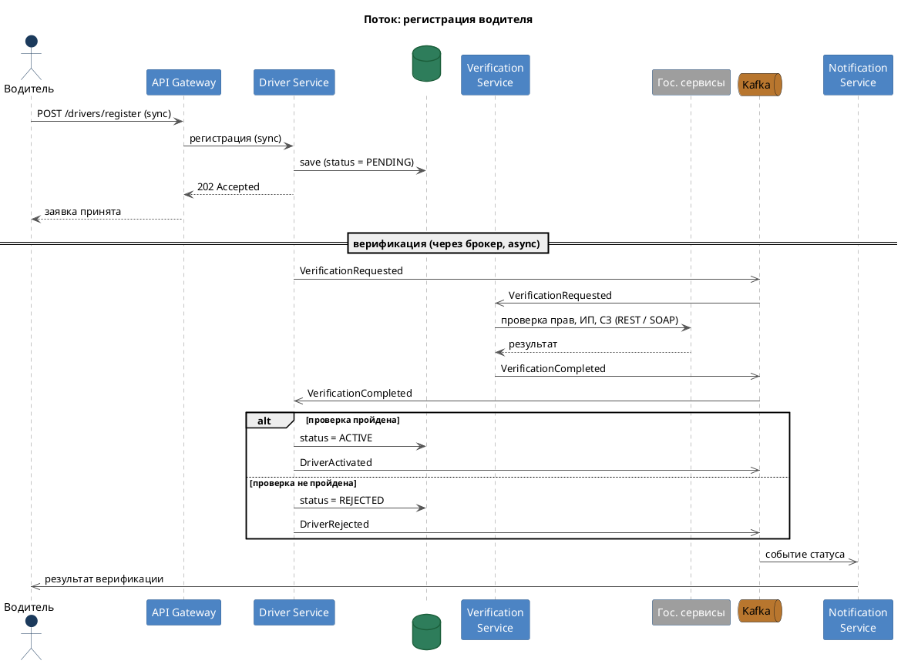
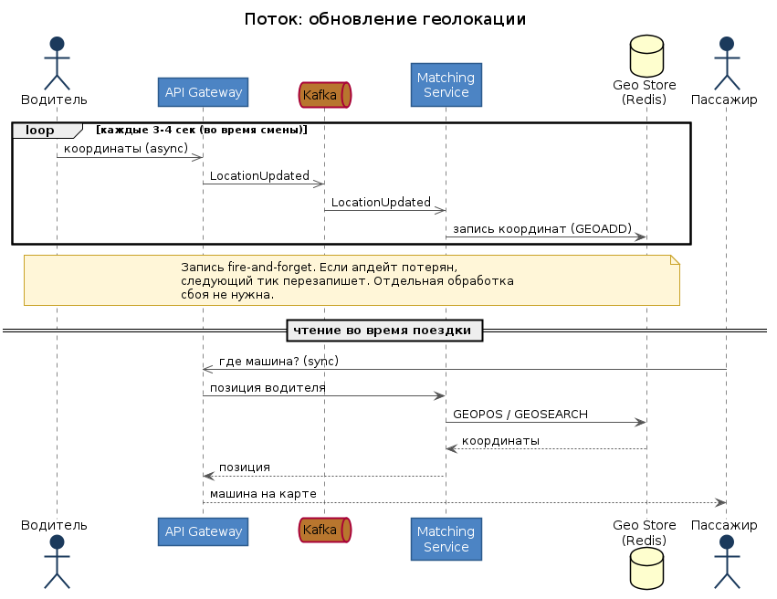
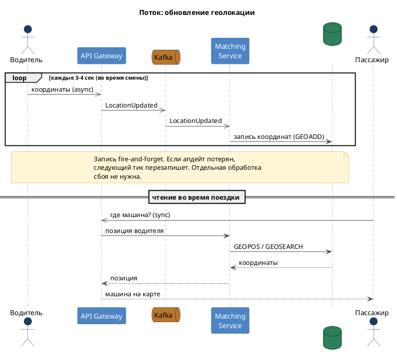

# ДЗ 1. Анализ референсной архитектуры — решение

> Условие: [../Задание.md](../Задание.md) · Чек-лист: [../Чеклист.md](../Чеклист.md)
> Схемы лежат в [diagrams/](diagrams/) (PNG для просмотра, PlantUML-исходники для правок).

## Выбранная архитектура

Сервис такси (Uber / Яндекс Go).

Система сводит в одной сделке трёх акторов: пассажира, водителя и платформу. Отдельно стоит оператор поддержки, у него свой админский интерфейс. Пассажир заказывает поездку, водитель её принимает и везёт, платформа отвечает за подбор, расчёт цены, оплату и уведомления.

**Оценка масштаба (порядок величин).**

| Параметр | Значение | Как посчитано |
|---|---|---|
| Активные пользователи (DAU) | ~12 млн | оценка по аудитории крупного сервиса |
| Одновременных поездок в пик | ~250k | доля активных пользователей в час пик |
| Read от пассажиров | ~83k RPS | 250k × 0.33 (запрос раз в ~3 сек) |
| Водителей онлайн в пик | ~1 млн | соотношение водитель/пассажир ~1:10 |
| Write геолокации водителей | ~250k RPS | 1 млн × 0.25 (запись раз в ~3–4 сек) |
| **Суммарно в пик** | **~340k RPS** | 83k (read) + 250k (write) |

Главный вывод из оценки: доминирует поток записи геолокации (~250k RPS). Это сразу диктует выбор хранилища для гео (in-memory слой вместо построчной записи в реляционную БД).

### Схема архитектуры (Container)

PlantUML-исходник

## 1. Компоненты

| Компонент | Тип | Зона ответственности                                                                                                                                                                       | State                  |
|---|---|--------------------------------------------------------------------------------------------------------------------------------------------------------------------------------------------|------------------------|
| Client App | Клиент (Android / iOS / Web) | Отображение, отправка геолокации и данных поездки. Вне контура платформы.                                                                                                                  | —                      |
| API Gateway | Шлюз | Роутинг запросов по path, балансировка, аутентификация (проверка auth-заголовков, связь с LDAP).                                                                                           | stateless              |
| User Service | Сервис + PostgreSQL | Данные пассажиров (ФИО, телефон, почта), регистрация.                                                                                                                                      | stateful (через БД)    |
| Driver Service | Сервис + PostgreSQL | Данные водителей и их регистрация. Выделен из User для отдельной обработки и верификации.                                                                                                  | stateful               |
| Verification Service | Сервис | Верификация водителей через гос. API (права, ИП, самозанятость). REST / SOAP.                                                                                                              | stateless              |
| Ride Service | Сервис + PostgreSQL | Поездки: создание, статусы, история. Событийная связь с Matching и Notification.                                                                                                           | stateful               |
| Matching Service | Сервис + Redis Geo + PostgreSQL | Ядро системы: подбор водителя, обработка геолокации, учёт час-пиков, рейтингов, форс-мажоров. Расчет поездки. Сам по себе сервис получается большой, поэтому требует более мелкой нарезки. | stateful (гео в Redis) |
| Payment Service | Сервис + PostgreSQL | Оплата, история, интеграции с провайдерами. Транзакционность через Saga.                                                                                                                   | stateful               |
| Notification Service | Сервис + PostgreSQL | Уведомления по каналам (push / SMS / email), шаблоны.                                                                                                                                      | stateful               |
| Support Service | Сервис | Техподдержка: доступ к сервисам, чтение всех событий из брокера, админ-интерфейс оператора.                                                                                                | stateless              |
| Message Broker | Kafka | Асинхронный обмен событиями между сервисами, буфер под нагрузку.                                                                                                                           | stateful (инфра)       |

Внешние системы: LDAP (каталог учёток), гос. сервисы (верификация), платёжные провайдеры (эквайринг), каналы доставки уведомлений.

## 2. Потоки данных

Ниже три ключевых сценария со схемами. Они покрывают разные типы взаимодействия: синхронный запрос-ответ, асинхронную обработку через брокер, обработку сбоев и горячий путь геолокации. Остальные сценарии (история поездок, отмена, изменение профиля, добавление способа оплаты) проще и сводятся к синхронному запросу в соответствующий сервис, для них схемы не нужны.

### 2.1 Создание поездки

Самый богатый сценарий. Поездка создаётся синхронно в Ride Service, дальше подбор водителя идёт асинхронно через брокер, статусы прилетают пассажиру через Notification.

- При сбое на этапе создания поездка помечается `FAILED`, пассажир получает уведомление. По дефолту, если retry, то будет использоваться изначальная поездка, только с новым статусом, но пассажир сможет создать новую, если будет необходимо.
- При сбое матчинга (нет водителя) процесс поиска перезапускается, статус возвращается в `SEARCHING`.

PlantUML-исходник

### 2.2 Регистрация водителя

Похож на регистрацию пассажира, но с дополнительной верификацией через гос. сервисы. Заявка принимается синхронно, верификация идёт асинхронно, результат прилетает водителю уведомлением.

PlantUML-исходник

### 2.3 Обновление геолокации

Горячий путь. Водитель шлёт координаты каждые несколько секунд, запись идёт асинхронно в Geo Store. Отдельная обработка сбоя не нужна: следующий тик перезапишет. Вторая половина схемы показывает обратную сторону, как пассажир читает позицию машины во время поездки.

PlantUML-исходник

### Прочие сценарии (без схем)

- **История поездок** — синхронный запрос в Ride Service.
- **Отмена поездки** — синхронно в Ride (смена статуса), асинхронно в Matching (остановка поиска) и Notification (уведомление).
- **Изменение данных профиля** — синхронный запрос в User Service.
- **Добавление способа оплаты** — синхронный запрос в Payment Service.
- **Обновление геолокации пассажира** — асинхронно в Matching, без обработки сбоя (следующий апдейт достаточен).

## 3. Проблемы и решения

**API Gateway.** Решает маршрутизацию: пользователи дёргают разные фичи, gateway по path подбирает нужный сервис (например, история поездок идёт в Ride Service). Без него каждый сервис должен был бы иметь публичное API, что увеличивает поверхность атаки и требует ресурсов на поддержку публичности. Здесь же балансировка нагрузки по инстансам (при больших объёмах балансировщик выносится отдельно) и аутентификация через проверку auth-заголовков фильтрами. 
Trade-off: единая точка входа упрощает безопасность и роутинг, но становится узким местом и точкой отказа.

**User Service.** Классический CRUD с БД плюс регистрация. Хранит данные пассажиров.

**Driver Service.** Выделен из User Service, чтобы отдельно вести данные водителей и их жизненный цикл (PENDING → ACTIVE / REJECTED). Разделение упрощает верификацию и снижает связанность: логика по водителям не раздувает пользовательский сервис.

**Verification Service.** Интеграции с гос. сервисами через SOAP / REST. Без отдельного сервиса эту логику пришлось бы держать в User/Driver, что увеличило бы его и усложнило поддержку и масштабирование.

**Ride Service.** В основе тот же CRUD, но с событийной архитектурой поверх: публикует события поездки для Matching, Notification и других сервисов. Trade-off: событийная архитектура добавляет асинхронности, скорости, но усложняет логику обработки различных статусов поездки. 

**Matching Service.** Ядро и самый сложный сервис. Главный вопрос — где хранить гео-данные; хороший вариант Redis Geo, он эффективно тянет большие потоки. Сервис учитывает час-пики, форс-мажоры, рейтинги, расчет стоимости. Без него нет подбора водителей либо появляются ненужные усложнения. Масштабируется хорошо: под ним Redis и брокеры (и то, и другое хорошо реплицируется), плюс сама логика это допускает. Брокер используется как буфер: сервис разбирает поездки по мере готовности. Получается довольно большой сервис, поэтому в реальном приложении, каждая часть логики будет вынесена в отдельный сервис.
Trade-offs: Redis Geo - это inmemory хранилише, поэтому в случае его падения, придется ждать некоторого ощутимого времени на восстановления'

**Payment Service.** Интеграции с платёжными системами, обязательная транзакционность. Поэтому Saga: распределённая транзакция через несколько шагов с компенсациями при сбое. Trade-offs: Saga - про надежность, но добавляет сложности на логику компенсаций

**Notification Service.** Отправка уведомлений по каналам (SMS, email, push), хранение шаблонов. Без отдельного сервиса логику отправки и шаблоны пришлось бы дублировать в каждом сервисе, который шлёт уведомления. Легко масштабируется, брокер работает буфером.

**Support Service.** Техподдержка: доступ к сервисам и чтение всех событий из брокера, отдельный админ-интерфейс оператора для поиска заказов и пользователей. Вынесен отдельно, чтобы не смешивать инструменты оператора с клиентскими API и не давать поддержке прямой доступ в чужие БД.

## 4. Вопросы к авторам архитектуры

1. Какие решения используются при нестабильном GPS-сигнале (центр Москвы или глухая местность без покрытия)?
2. Как обрабатывается всплеск нагрузки в форс-мажоры (много незапланированных заказов одновременно), какие здесь особенности?
3. В каком месте подключение кэша дало самый большой вклад?
4. Какая неочевидная технология порадовала больше всего и каким образом ?
5. От какой популярной технологии было больше всего разочарования и почемк?
6. На что уходит больше всего ресурсов и денег?