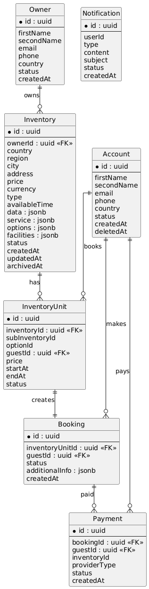
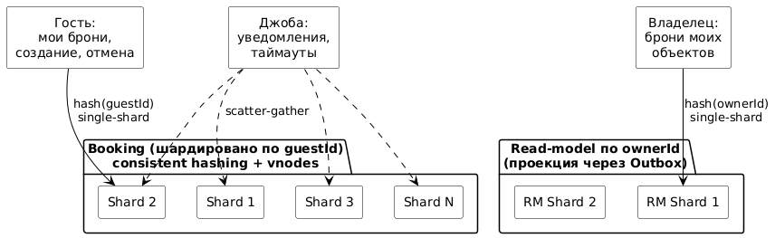

# ДЗ 3. Проектирование хранения данных — решение

> Условие: [../Задание.md](../Задание.md)
> Шаблоны: [сравнение БД](../Таблица%20сравнения%20БД%20с%20критериями%20выбора.md) ·
> [кэширование](../Чек-лист%20стратегий%20кэширования.md) ·
> [шардирование](../Шаблон%20схемы%20шардирования.md). Схемы — в [diagrams/](diagrams/).

> Выполняется для системы, выбранной в ДЗ 2.

# ДЗ 3. Проектирование хранения данных

**Система:** сервис бронирования (аналог Booking.com), продолжение ДЗ 2.

---

## 1. Модель данных

ER-диаграмма связей между сущностями (файл `hw3-er.png`):



Ниже поля по каждому сервису. API Gateway stateless, своих данных не хранит, поэтому в модели его нет.

### Account (гость)
```
id, firstName, secondName, email, phone, country,
status (UNVERIFIED, VERIFIED, BLOCKED),
createdAt, deletedAt
```

### Owner (владелец)
```
id, firstName, secondName, email, phone, country,
status (UNDER_VERIFICATION, VERIFIED, REJECTED, BLOCKED),
createdAt
```
Статус нужен, потому что владелец проходит верификацию перед тем, как его объекты можно публиковать. Публикация Inventory гейтится по `status = VERIFIED`.

### Inventory (объект)
Ядро схемы стабильное (id, локация, цена, тип, статус), разнородная часть по типам объекта уходит в JSONB.
```
id, ownerId, country, region, city, address,
price, currency,
type (HOTEL, HOTEL_ROOM, VILLA, APART, HOSTEL_PLACE, HOSTEL_ROOM ...),
availableTime,
data: jsonb        -- зависит от типа: для HOTEL_ROOM список номеров {id, price, currency, bedCount, wc, service, options}, для APART {kitchen, bedroom, shower ...}
service: jsonb     -- зависит от типа: sofa, minibar, fan, conditioner ...
options: jsonb     -- [{id, inventoryId, price, noFeeRefund, breakfast ...}]
facilities: jsonb  -- зависит от типа: spa, restaurant, gym, pool ...
status (NEW, UNDER_REVIEW, PUBLISHED, REJECTED, UNLISTED, ARCHIVED),
createdAt, updatedAt, archivedAt
```

### Inventory Unit (бронируемая единица на календаре)
```
id, inventoryId, subInventoryId (id из data в Inventory), optionId,
guestId, price,
startAt, endAt,
status (NEW, APPROVED, DECLINED, CANCELED)
```
Против двойной брони одной единицы на пересекающиеся даты нужен констрейнт на пересечение диапазонов (в PostgreSQL это `EXCLUDE USING gist` по `(inventoryId, subInventoryId, optionId, tsrange(startAt, endAt))`).

### Booking (процесс брони, история)
```
id, inventoryUnitId, guestId,
status (CREATED, IN_PROGRESS, ON_REVIEW, CONFIRMED, REJECTED, CANCELED, PAID),
additionalInfo: jsonb {who, tripType (business, private), comment ...},
createdAt
```

### Payment
```
id, bookingId, guestId, inventoryId, providerType,
status (NEW, PENDING, DONE, FAILED, RETRY),
createdAt
```

### Notification
```
id, userId (guestId или ownerId), type (PUSH, SMS, EMAIL),
content, subject,
status (NEW, IN_PROGRESS, SENT, RETRY, FAILED),
createdAt
```

### Search
Отдельного хранилища-таблицы нет, это индексы в Elasticsearch. По сути повторяет схему Inventory плюс инфа о доступности вариантов.

---

## 2. Выбор БД

| Сервис | Что хранит | Форма данных | Ключевые запросы | БД | Почему именно она |
|---|---|---|---|---|---|
| Account | профиль гостя | реляционная | по id, по email | PostgreSQL | немного данных, нужны ACID и уникальность email |
| Owner | профиль владельца | реляционная | по id | PostgreSQL | то же, что и Account |
| Inventory | объекты + разнородные атрибуты | реляционное ядро + JSONB | по id, по ownerId | PostgreSQL + JSONB | ядро схемы стабильно, разнородность в JSONB. Mongo не нужен: поиск закрыт ES, масштабирование репликацией и шардированием PSQL |
| Inventory Unit | занятость единиц по датам | реляционная, нужны констрейнты | по inventoryId, пересечение дат | PostgreSQL | нужен exclusion-констрейнт против овербукинга |
| Booking | процесс и история броней | реляционная, транзакции | по id, по guestId | PostgreSQL | ACID на смене статусов, история |
| Payment | платежи и их статусы | реляционная, транзакции | по bookingId, по guestId | PostgreSQL | деньги, строгая консистентность |
| Notification | исходящие уведомления | реляционная | по статусу, по userId | PostgreSQL | простое хранилище статусов, транспорт через Kafka |
| Search | индекс объектов + доступность | документная, инвертированный индекс | полнотекст, фасеты, фильтры | Elasticsearch | поиск по многим атрибутам и ранжирование, для чего PSQL не оптимизирован |
| (Redis) | кэш + холды | key-value | по ключу | Redis | горячие чтения и короткоживущие холды с TTL (детали в разделе кэширования) |

Итого три типа хранилищ: PostgreSQL как основной source of truth, Elasticsearch под поиск, Redis под кэш и холды.

---

## 3. Шардирование

Шардирую один ключевой сервис, Booking. Остальные на обозримых объёмах шардировать не надо.



| Сервис | Что шардируем | Ключ | Стратегия | Шарды (старт) | Ребалансировка | Главный риск + как лечим |
|---|---|---|---|---|---|---|
| Booking | таблицу броней | guestId | consistent hashing + виртуальные узлы | 4 | добавление узла двигает ~1/N данных | scatter-gather у владельцев и джоб → read-model по ownerId + события; перекос → виртуальные узлы |

**Зачем шардируем.** Booking это самая быстрорастущая сущность в системе. Пишется постоянно, накапливается бесконечно, одним узлом ни объём (годы истории), ни запись в пик не вытянуть. Остальные сервисы обходятся вертикальным масштабированием и репликами.

**Ключ.** `guestId`. Гость чаще всего работает со своими бронями: смотрит список, открывает карточку, отменяет, создаёт новую. Все эти запросы по `guestId` попадают в один шард. По прикидке это около 45% трафика, то есть ключ покрывает основной сценарий.

**Стратегия.** Consistent hashing с виртуальными узлами. Равномерное распределение и возможность добавлять шарды без массового переезда данных.

**Что на ключ не ложится и как закрываю.**

Владелец, который смотрит брони по своим объектам, при таком ключе получит scatter-gather. Решаю отдельной read-моделью в Booking, шардированной уже по `ownerId`. Синхронизируется через Transactional Outbox из основной таблицы. Eventual consistency в пределах секунд, для сценария владельца этого хватает.

**Джобы** делю на два типа. Те, что реагируют на смену статуса оплаты или изменение брони, работают через события: Payment публикует результат, консьюмер в Booking его обрабатывает, сканировать шарды не нужно. Те, что идут по расписанию (уведомления, автоотмена по таймауту), делают scatter-gather с фильтром по времени. Это фоновые джобы, ждать они могут, поэтому обход всех шардов тут не проблема.

**Trade-offs.** Read-модель по `ownerId` удваивает запись и объём, между копиями возможен рассинхрон в несколько секунд. Кросс-шардовые транзакции невозможны в привычном виде, распределённая согласованность идёт через Saga.

---

## 4. Кэширование

Кэшируем выборочно, не всё подряд.

| Что кэшируем | Уровень | Стратегия | TTL | Инвалидация | Зачем |
|---|---|---|---|---|---|
| Атрибуты Inventory Unit (описание, фото) | Redis | cache-aside | 1 час | событие `UnitUpdated` | снять с БД частые чтения редко меняющихся данных |
| Календарь доступности единицы | Redis + локальный Caffeine в Search | cache-aside | 30–60 сек | события `BookingConfirmed` / `BookingCancelled` + TTL как страховка | фильтрация в поиске без тысяч запросов в БД в пик |
| Агрегаты по городам/странам (фасеты для UI) | Redis | cache-aside | 5–10 мин | TTL | рендер фильтр-панели и счётчиков |
| Промо и рекомендации на главной | Caffeine + Redis (двухуровневый) | cache-aside | от 10 мин | событие из админки | массовое чтение, редкие обновления, дорогое вычисление |
| Активные холды («в корзине») | Redis как первичка, не кэш | — | 15 мин (natural TTL) | — | быстрые операции put/del + автоочистка по TTL |

**Что не кэшируем.** Search целиком (полный набор фильтров уникален, hit rate низкий). Account и Owner (профиль читается редко в абсолютных числах, PostgreSQL с индексом справляется, кэш по инерции не оправдан).

**Про календарь доступности.** Кэш используется только для фильтрации на этапе поиска. Финальное решение «свободно или нет» принимается в момент создания холда прямым запросом к БД под распределённым локом. Кэш может ошибочно показать единицу свободной, но при коммите система вернёт «занято», овербукинга не будет.

---

## 5. Очереди

Брокер (Kafka) применяю там, где не нужна синхронная обработка результата, где действие порождает параллельную обработку связанных вещей или где уместна батчевая обработка.

- **Синхронизация read-моделей и Search.** Изменения Inventory, Inventory Unit и Booking публикуются событиями, Search и проекции консьюмят и обновляют себя.
- **Уведомления.** Сервисы шлют события «нужно уведомить», Notification складывает их и обрабатывает батчами.
- **Смена статусов между сервисами.** Смена статуса оплаты ведёт к смене статуса в Booking и Inventory Unit, это идёт событиями, а не синхронными вызовами.
- **Transactional Outbox.** Смена статуса и публикация события пишутся в одной локальной транзакции, чтобы не потерять событие при сбое.

---

## 6. CAP trade-offs

В классической формулировке говорят про выбор из трёх, но по факту P (устойчивость к разрыву сети) неизбежна. Поэтому реальный компромисс это CP или AP в момент сетевого разрыва.

| Сервис | Выбор | Обоснование |
|---|---|---|
| Gateway | AP | важно, чтобы был доступен и выполнил роутинг, фильтрацию, лимитинг. Своих данных почти нет, только конфигурация, актуальность не критична |
| Auth | CP | данные для входа должны быть максимально консистентны, иначе пустим не того или не пустим того |
| Account, Owner | CP | по той же логике, что и Auth |
| Booking | CP | нужно актуальное состояние броней |
| Inventory | AP | лучше показать пусть не самые свежие данные, чем ничего. Объекты меняются редко, в итоге всё равно сойдётся |
| Inventory Unit | CP | нужны точные данные по занятости, от них зависят другие Inventory Unit и Booking |
| Search | AP | как Inventory, лучше отдать хоть что-то |
| Payment | CP | платежи максимально консистентны, либо всё, либо ничего |
| Notification | AP | достаточно at-least-once и eventual delivery: главное, чтобы уведомление в итоге ушло, а не чтобы все узлы были согласованы в моменте |

