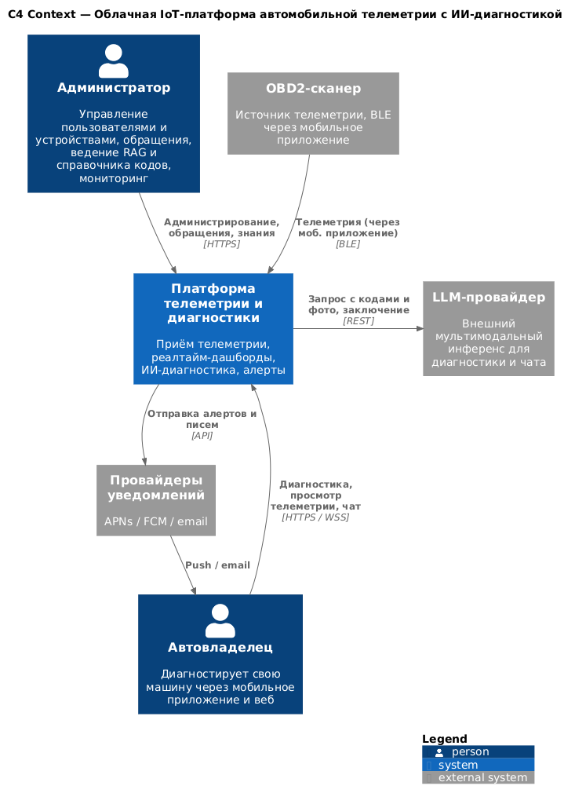
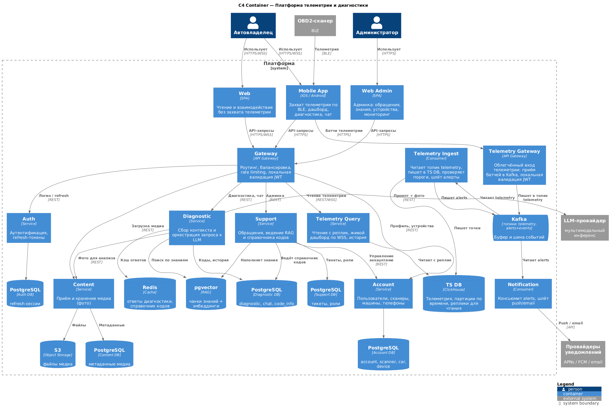

# 2. Концептуальная архитектура

## 2.1. Схема концептуальной архитектуры (C4)

### Context



Платформа в центре, вокруг — два человека-актора (автовладелец, администратор) и три внешние системы (OBD2-сканер, LLM-провайдер, провайдеры уведомлений). Захват телеметрии со сканера идёт по BLE только через мобильное приложение; уведомления доставляются пользователю через внешних провайдеров.

<details>
<summary>PlantUML (C4 Context)</summary>

```plantuml
@startuml c1_context
!include https://raw.githubusercontent.com/plantuml-stdlib/C4-PlantUML/master/C4_Context.puml

title C4 Context — Облачная IoT-платформа автомобильной телеметрии с ИИ-диагностикой

Person(owner, "Автовладелец", "Диагностирует свою машину через мобильное приложение и веб")
Person(admin, "Администратор", "Управление пользователями и устройствами, обращения, ведение RAG и справочника кодов, мониторинг")

System(platform, "Платформа телеметрии и диагностики", "Приём телеметрии, реалтайм-дашборды, ИИ-диагностика, алерты")

System_Ext(scanner, "OBD2-сканер", "Источник телеметрии, BLE через мобильное приложение")
System_Ext(llm, "LLM-провайдер", "Внешний мультимодальный инференс для диагностики и чата")
System_Ext(push, "Провайдеры уведомлений", "APNs / FCM / email")

Rel(owner, platform, "Диагностика, просмотр телеметрии, чат", "HTTPS / WSS")
Rel(admin, platform, "Администрирование, обращения, знания", "HTTPS")
Rel(scanner, platform, "Телеметрия (через моб. приложение)", "BLE")
Rel_R(platform, llm, "Запрос с кодами и фото, заключение", "REST")
Rel(platform, push, "Отправка алертов и писем", "API")
Rel(push, owner, "Push / email", "")

SHOW_LEGEND()
@enduml
```
</details>

### Container



Ключевые особенности:
- Два входа: общий **Gateway** (разнородные запросы, валидация JWT, роутинг) и отдельный **Telemetry Gateway** (облегчённый горячий вход телеметрии).
- **Kafka** как буфер и шина: топик телеметрии (буфер перед записью) и топик алертов/событий.
- CQRS-контур телеметрии: **Telemetry Ingest** пишет в TS DB (и считает алерты), **Telemetry Query** читает с реплик и стримит живой дашборд по WebSocket.
- Polyglot-хранение: TS DB под поток, PostgreSQL под аккаунты/коды/тикеты, pgvector под RAG, S3 под медиа, Redis под кэш.

<details>
<summary>PlantUML (C4 Container)</summary>

```plantuml
@startuml c2_container
!include https://raw.githubusercontent.com/plantuml-stdlib/C4-PlantUML/master/C4_Container.puml

title C4 Container — Платформа телеметрии и диагностики

Person(owner, "Автовладелец")
Person(admin, "Администратор")
System_Ext(scanner, "OBD2-сканер", "BLE")
System_Ext(llm, "LLM-провайдер", "мультимодальный инференс")
System_Ext(push, "Провайдеры уведомлений", "APNs / FCM / email")

System_Boundary(platform, "Платформа") {

    Container(mobile, "Mobile App", "iOS / Android", "Захват телеметрии по BLE, дашборд, диагностика, чат")
    Container(web, "Web", "SPA", "Чтение и взаимодействие без захвата телеметрии")
    Container(webadmin, "Web Admin", "SPA", "Админка: обращения, знания, устройства, мониторинг")

    Container(gw, "Gateway", "API Gateway", "Роутинг, балансировка, rate limiting, локальная валидация JWT")
    Container(tgw, "Telemetry Gateway", "API Gateway", "Облегчённый вход телеметрии: приём батчей в Kafka, локальная валидация JWT")
    Container(auth, "Auth", "Service", "Аутентификация, refresh-токены")

    ContainerQueue(kafka, "Kafka", "топики: telemetry, alerts+events", "Буфер и шина событий")

    Container(ingest, "Telemetry Ingest", "Consumer", "Читает топик telemetry, пишет в TS DB, проверяет пороги, шлёт алерты")
    Container(query, "Telemetry Query", "Service", "Чтение с реплик, живой дашборд по WSS, история")

    Container(diag, "Diagnostic", "Service", "Сбор контекста и оркестрация запроса к LLM")
    Container(content, "Content", "Service", "Приём и хранение медиа (фото)")
    Container(account, "Account", "Service", "Пользователи, сканеры, машины, телефоны")
    Container(support, "Support", "Service", "Обращения, ведение RAG и справочника кодов")
    Container(notif, "Notification", "Consumer", "Консьюмит alerts, шлёт push/email")

    ContainerDb(tsdb, "TS DB", "ClickHouse", "Телеметрия, партиции по времени, реплики для чтения")
    ContainerDb(pg_acc, "PostgreSQL", "Account DB", "account, scanner, car, device")
    ContainerDb(pg_auth, "PostgreSQL", "Auth DB", "refresh-сессии")
    ContainerDb(pg_diag, "PostgreSQL", "Diagnostic DB", "diagnostic, chat, code_info")
    ContainerDb(rag, "pgvector", "RAG", "чанки знаний + эмбеддинги")
    ContainerDb(pg_cont, "PostgreSQL", "Content DB", "метаданные медиа")
    ContainerDb(s3, "S3", "Object Storage", "файлы медиа")
    ContainerDb(pg_sup, "PostgreSQL", "Support DB", "тикеты, роли")
    ContainerDb(redis, "Redis", "Cache", "ответы диагностики, справочник кодов")

}

' --- клиенты
Rel(scanner, mobile, "Телеметрия", "BLE")
Rel(owner, mobile, "Использует", "HTTPS/WSS")
Rel(owner, web, "Использует", "HTTPS/WSS")
Rel(admin, webadmin, "Использует", "HTTPS")

' --- вход телеметрии (горячий путь)
Rel(mobile, tgw, "Батчи телеметрии", "HTTPS")
Rel(tgw, kafka, "Пишет в топик telemetry", "")

' --- вход обычный
Rel(mobile, gw, "API-запросы", "HTTPS")
Rel(web, gw, "API-запросы", "HTTPS/WSS")
Rel(webadmin, gw, "API-запросы", "HTTPS")
Rel(gw, auth, "Логин / refresh", "REST")
Rel(auth, pg_auth, "", "")

' --- gateway -> сервисы
Rel(gw, query, "Чтение телеметрии", "REST/WSS")
Rel(gw, diag, "Диагностика, чат", "REST")
Rel(gw, content, "Загрузка медиа", "REST")
Rel(gw, account, "Профиль, устройства", "REST")
Rel(gw, support, "Админка", "REST")

' --- телеметрический контур (буфер)
Rel(kafka, ingest, "Читает telemetry", "")
Rel(ingest, tsdb, "Пишет точки", "")
Rel(ingest, kafka, "Пишет alerts", "")
Rel(query, tsdb, "Читает с реплик", "")

' --- диагностика
Rel(diag, pg_diag, "Коды, история", "")
Rel(diag, rag, "Поиск по знаниям", "")
Rel(diag, redis, "Кэш ответов", "")
Rel(diag, content, "Фото для анализа", "REST")
Rel_R(diag, llm, "Промпт + фото", "REST")

' --- прочее хранение
Rel(content, s3, "Файлы", "")
Rel(content, pg_cont, "Метаданные", "")
Rel(account, pg_acc, "", "")
Rel(support, pg_sup, "Тикеты, роли", "")
Rel(support, pg_diag, "Ведёт справочник кодов", "")
Rel(support, rag, "Наполняет знания", "")
Rel(support, account, "Управление аккаунтами", "REST")

' --- уведомления
Rel(kafka, notif, "Читает alerts", "")
Rel(notif, push, "Push / email", "API")

SHOW_LEGEND()
@enduml
```
</details>

## 2.2. Описание компонентов

**Клиенты**
- **Mobile App** — единственный источник захвата телеметрии (BLE), плюс дашборд, диагностика, чат.
- **Web** — то же на чтение и взаимодействие, без захвата телеметрии; заточен под десктоп.
- **Web Admin** — интерфейс администратора: обращения, знания, устройства, мониторинг.

**Вход**
- **Gateway** — роутинг клиентских запросов, балансировка, rate limiting; валидирует JWT локально, в Auth ходит только на login/refresh; своей БД не имеет, легко масштабируется.
- **Telemetry Gateway** — облегчённый вход для потока телеметрии (десятки тысяч RPS в пик): минимум логики, лёгкая локальная валидация токена, задача — быстро принять батч и положить в Kafka.
- **Auth** — аутентификация и авторизация; хранит refresh-токены; access — самоподписанный JWT, в базе не хранится.

**Телеметрия**
- **Telemetry Ingest** — консьюмер топика телеметрии: читает буфер, пишет в TS DB своим темпом, параллельно проверяет пороги и кладёт события в топик алертов. Совмещение записи и алертинга — осознанное решение для MVP.
- **Telemetry Query** — read-сторона: живой дашборд (WebSocket), история поездок и заключений; читает с реплик TS DB.

**Диагностика и контент**
- **Diagnostic** — собирает контекст (справочник кодов из PostgreSQL, знания из RAG, фото из Content) и оркестрирует запрос к внешнему LLM; кэширует ответы в Redis.
- **Content** — приём и хранение медиа (на MVP только фото): файлы в S3, метаданные в PostgreSQL.

**Пользователи и поддержка**
- **Account** — пользователи и их устройства; здесь живёт связка «аккаунт — сканер — машина — телефон».
- **Support** — обращения, ведение справочника кодов и RAG, управление аккаунтами через Account.

**Уведомления**
- **Notification** — консьюмер топика алертов; доставляет push/email через внешних провайдеров, email как резервный канал.

## 2.3. Обоснование архитектурного стиля

Выбрана **микросервисная** архитектура. Обоснование растёт из профиля системы, а не из моды.

**За:**
- **Независимое масштабирование.** Разброс нагрузки внутри системы: ingestion до 10 000 RPS против единичных запросов диагностики. Горячий контур масштабируется отдельно.
- **Изоляция отказов.** Отказ LLM останавливает диагностику, но телеметрия продолжает приниматься и писаться — основа graceful degradation.
- **Polyglot-хранение.** Каждый сервис берёт хранилище под свой профиль данных.

**Цена, которую принимаем:**
- Распределённость (сеть, задержки, таймауты, ретраи).
- Сложность данных (нет единой транзакции; согласованность через Kafka и eventual consistency).
- Эксплуатация (больше движущихся частей: сервисы, брокер, несколько БД).

Для системы с ровной нагрузкой это был бы оверинжиниринг. Здесь стиль оправдан асимметрией нагрузки: монолит пришлось бы масштабировать целиком ради одного горячего контура.

## 2.4. ADR

### ADR-001. Kafka как буфер для записи телеметрии в TS DB

**Статус:** Accepted

**Контекст.** В пик запись телеметрии доходит до ~200k точек/сек. Держать БД под такую нагрузку постоянно — простой дорогих мощностей; держать меньше — тормоза записи в пик, деградация UX, риск целостности данных.

**Решение.** Поставить между приёмом и записью буферную шину Kafka.

**Последствия.**
- Плюсы: БД не масштабируется под пик, консьюмеры разгребают буфер ровным темпом; при сбое записи данные перечитываются из Kafka; несколько консьюмер-групп поверх одного потока (запись и алертинг независимо).
- Минусы: лишнее звено и рост сложности; при отказе Kafka запись может встать — нужен fallback (локальное сохранение на клиенте с обратным заполнением); Kafka требует отдельной инфраструктуры и наблюдения.

**Альтернативы.**
- RabbitMQ: удаляет сообщение после подтверждения — перечитать при сбое нельзя; рассчитан на меньший throughput.
- Прямая запись в БД: проще, но нагрузка на запись неконтролируема в пик.

### ADR-002. Чтение телеметрии с реплик TS DB

**Статус:** Accepted

**Контекст.** Поток пишется в TS DB через Ingest, читается через Query для дашбордов и истории. Нужно развести нагрузку чтения и записи.

**Решение.** Запись в master, чтение с реплик. Это скорее *стиль* CQRS, чем полная реализация: реплика не является полноценным Q — та же структура данных, та же СУБД, тот же формат запросов.

**Последствия.**
- Плюсы: чтение масштабируется репликами независимо; репликация из коробки; гибкие стратегии масштабирования.
- Минусы: лаг репликации (данные на репликах чуть позже); эксплуатация требует экспертизы; больше места под реплики — но это же даёт отказоустойчивость.

**Альтернативы.**
- Полный CQRS с материализованной read-моделью (отдельный консьюмер пишет в отдельную БД чтения в другой схеме). Оправдан, когда форма чтения отличается от формы записи; здесь форма совпадает — лишний код и место.
- Чтение из той же БД: просто, но в пик чтение конкурирует с записью и живой дашборд тормозит.

## 2.5. Пользователи и внешние интеграции

### Пользователи
- **Автовладелец** — мобильное приложение (полный доступ, включая захват по BLE) и веб (то же, кроме захвата). Доступ только к своим данным.
- **Администратор** — веб-админка: обращения, RAG, справочник кодов, пользователи и устройства, мониторинг. Расширенный доступ.

### Внешние интеграции
- **OBD2-сканер** — источник телеметрии, BLE только через мобильное приложение, поток односторонний. Без сканера захват невозможен.
- **LLM-провайдер** — мультимодальный инференс, REST, синхронный запрос-ответ. Критичен; при недоступности fallback — выдача сырого кода ошибки.
- **Провайдеры уведомлений** (APNs / FCM / email) — доставка push и писем, email как резервный канал.

### Backlog интеграций
- Внешние источники знаний для RAG (форумы, дилеры, производители) — автонаполнение базы. На MVP база наполняется вручную через Support.