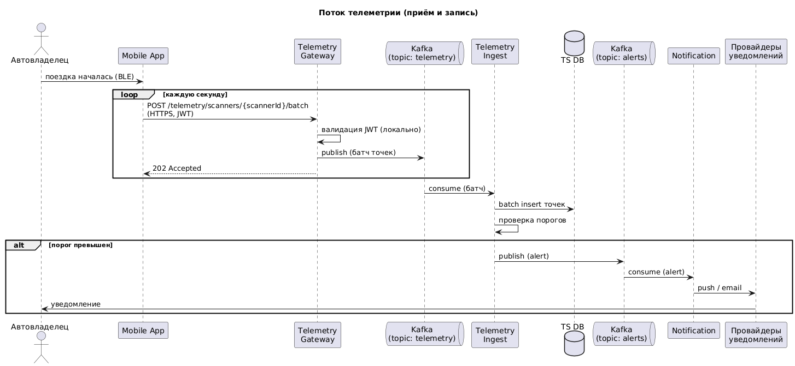
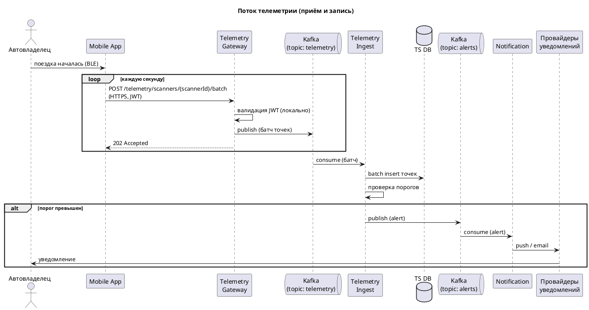
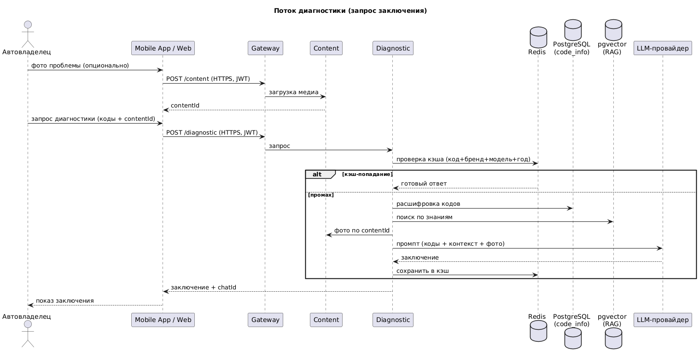
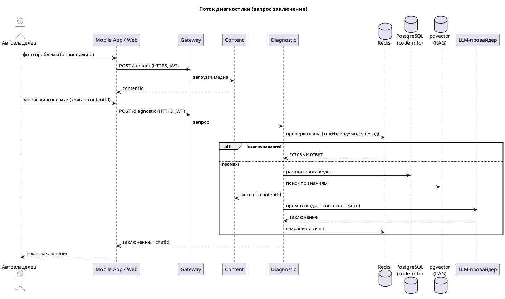

# 5. Взаимодействие

## 5.1. Схема взаимодействия сервисов

Взаимодействие разбито на три канала по профилю:

- **REST** — синхронное общение клиент→сервис и сервис→сервис на некритичных по нагрузке путях (диагностика, аккаунты, админка, загрузка медиа).
- **WebSocket (WSS)** — отдача живой телеметрии на дашборд (обратный канал, от Telemetry Query к клиенту).
- **Kafka** — асинхронный контур: буфер приёма телеметрии и шина событий (алерты, уведомления).

Важно: захват телеметрии идёт **вверх** батчами по HTTPS (на Telemetry Gateway → Kafka), а живое отображение идёт **вниз** по WSS (от Telemetry Query). Это разные направления и разные каналы.

### Поток телеметрии (приём и запись)



<details>
<summary>PlantUML (sequence: телеметрия)</summary>


</details>

### Поток диагностики (запрос заключения)



<details>
<summary>PlantUML (sequence: диагностика)</summary>


</details>

## 5.2. Выбор протоколов

**REST — основной протокол.** Простой, предсказуемый, хорошо ложится на синхронное общение клиент→сервис и сервис→сервис. Синхронность безопасна, потому что горячий путь (телеметрия) вынесен из REST в Kafka: под синхронным REST остаются только некритичные по нагрузке пути.

Альтернатива для меж-сервисного взаимодействия — **gRPC** (быстрее, строгие контракты), но он сложнее в поддержке и оправдан при интенсивном сервис-сервис трафике. В нашем профиле такого нет — REST достаточно.

**WebSocket (WSS) — для живой телеметрии.** Постоянный канал (Telemetry Query → клиент) даёт real-time отображение без постоянного опроса. Работает и для мобильного, и для веба (десктоп). Захват данных по WS не идёт — только отдача.

**Kafka — асинхронный контур.** Две роли: буфер приёма телеметрии (сглаживание пиков, см. ADR-001) и шина событий (алерты → Notification). Развязывает горячий приём от записи и позволяет нескольким консьюмерам обрабатывать один поток независимо.

**Аутентификация:** все клиентские запросы несут заголовок `Authorization: Bearer <JWT>`. Гейтвеи валидируют токен локально по подписи (без обращения в Auth на каждый запрос).

## 5.3. Ключевые API-контракты

### Приём телеметрии

Приложение накапливает замеры и шлёт батчем (в батче может быть несколько точек — в том числе досылка после разрыва связи).

```
POST /telemetry/scanners/{scannerId}/batch
Authorization: Bearer <JWT>

{
  "accountId": "uuid",
  "carId": "uuid",
  "points": [
    {
      "timestamp": "2026-01-20T10:15:00Z",
      "metrics": { "speed": 60, "engineSpeed": 2500, "oilTemperature": 95, ... }
    },
    { "timestamp": "...", "metrics": { ... } }
  ]
}

→ 202 Accepted
```

Путь: приложение → Telemetry Gateway → Kafka (topic telemetry) → Telemetry Ingest → batch insert в TS DB.

### Запрос диагностики

Медиа загружается заранее отдельным запросом в Content и передаётся сюда по `contentId` (файлы в JSON диагностики не кладутся).

```
POST /diagnostic
Authorization: Bearer <JWT>

{
  "accountId": "uuid",
  "scannerId": "uuid",
  "carId": "uuid",
  "codes": ["P0300", "P0171"],
  "description": "странный звук на холодную",
  "contentIds": ["uuid", "uuid"]
}

→ 200 OK
{
  "conclusion": "текст заключения",
  "chatId": "uuid"
}
```

Путь: Gateway → Diagnostic → (Redis-кэш → при промахе: PostgreSQL коды + RAG + Content по contentId + LLM) → ответ, сохранение в кэш.

### Чат с ассистентом

```
POST /diagnostic/chats/{chatId}/messages
Authorization: Bearer <JWT>

{
  "accountId": "uuid",
  "text": "а если проблема только на холодную?",
  "contentIds": ["uuid"]
}

→ 200 OK
{
  "text": "ответ ассистента"
}
```

Сообщение уходит в Diagnostic → LLM, ответ возвращается, переписка сохраняется в БД (chat/message).

### История телеметрии (для дашбордов)

POST (а не GET) из-за сложного тела с фильтрами и диапазоном. Ответ поддерживает гранулярность (downsampling) и лимит, чтобы не вернуть гигантский массив.

```
POST /telemetry/scanners/{scannerId}/search
Authorization: Bearer <JWT>

{
  "carId": "uuid",
  "metrics": ["SPEED", "ENGINE_TEMPERATURE"],
  "startedAt": "2026-01-20T10:00:00Z",
  "finishedAt": "2026-01-20T11:00:00Z",
  "granularity": "10s",
  "limit": 1000
}

→ 200 OK
{
  "series": [
    {
      "metric": "SPEED",
      "values": [ { "timestamp": "...", "value": 60 }, ... ]
    },
    { "metric": "ENGINE_TEMPERATURE", "values": [ ... ] }
  ]
}
```

Путь: Gateway → Telemetry Query → чтение с реплик TS DB.

### Привязка сканера к аккаунту

Ключевой сценарий: без привязки телеметрия обезличена.

```
POST /accounts/{accountId}/scanners
Authorization: Bearer <JWT>

{
  "serialNumber": "OBD-XXXX",
  "carId": "uuid"
}

→ 201 Created
{
  "scannerId": "uuid",
  "status": "ACTIVE"
}
```

Путь: Gateway → Account → запись связки scanner ↔ account ↔ car.

### Создание тикета в поддержку

```
POST /support/tickets
Authorization: Bearer <JWT>

{
  "accountId": "uuid",
  "ticketType": "QUESTION",
  "subject": "не привязывается сканер",
  "description": "текст обращения",
  "contentIds": ["uuid"]
}

→ 201 Created
{
  "ticketId": "uuid"
}
```

Путь: Gateway → Support → создание тикета (медиа — по contentId из Content).